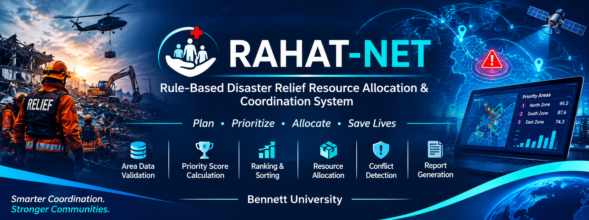

<p align="center">
  
</p>
# RAHAT-NET
### Rule-Based Disaster Relief Resource Allocation & Coordination System

**RAHAT-NET** is a Python-based decision-support system designed to help coordinate disaster relief resources among affected areas.

## Features
- Area data entry and validation
- Priority score calculation
- Ranking and sorting of affected areas
- Resource allocation and shortage detection
- Conflict detection
- Report generation in TXT and CSV formats

## Technologies Used
- Python
- CSV
- Datetime

## How to Run

1. Install Python 3.
2. Download or clone this repository.
3. Open a terminal in the project folder.
4. Run:

```bash
python RAHATNET_PROJECT.py
```

## Priority Calculation

The system calculates priority using:
- Severity: 35%
- Urgency: 35%
- Population: 20%
- Resource requirement: 10%

## Disclaimer
RAHAT-NET is a rule-based planning aid, not an AI system or an official disaster-management authority. Final relief decisions must be made by trained personnel.

## Developed At
Bennett University

Computational Thinking and Programming (2026CSAE100)
